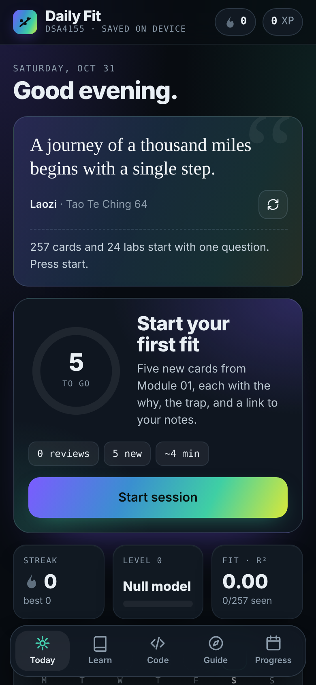
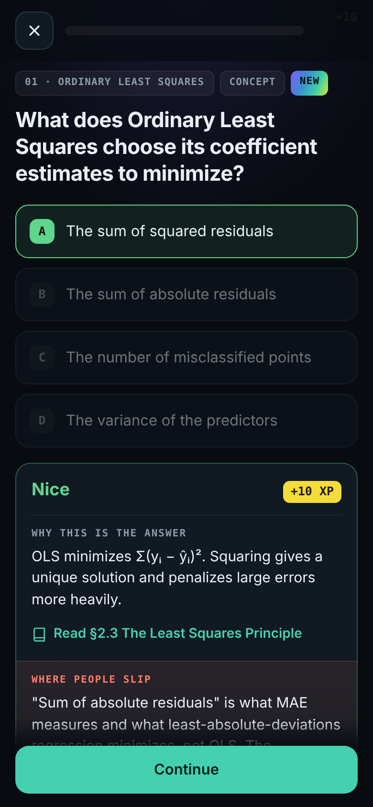
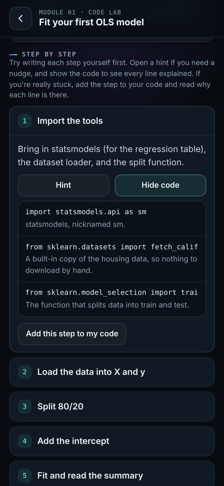
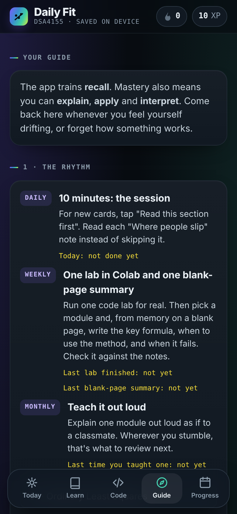

# Daily Fit

A phone-first study app I built to master my **Fundamentals of Data Science and Analytics** (DSA4155) review materials, ten minutes a day, with nothing to install.

There was no quiz date to push me through the material, so I made the app supply the pressure: spaced repetition, streaks, XP, and a plan that ends with real projects before graduation.

| Today | Question feedback | Guided code lab | Guide |
| --- | --- | --- | --- |
|  |  |  |  |

## What it does

- **Daily session with spaced repetition.** 257 questions across 10 modules (OLS, logistic regression, GLMs, KNN and trees, bagging and random forests, boosting, regularization, K-Means, DBSCAN, dimensionality reduction). Cards come back after 1, 3, 7, 14, 30, then 60 days. Misses come back the next day.
- **Learning, not just memorizing.** Every answer shows *why* it's right, *where people slip* (the common mistake or the concept it gets confused with), and which section of the course notebook to reread.
- **Learn to code from zero.** 11 beginner Python lessons, then 24 code labs using statsmodels, scikit-learn and xgboost. Each lab has step-by-step walkthroughs with every line explained, plus instant checks.
- **Gamified, but honest.** Streaks with freezes, XP and levels, badges, a progress ring, and a heatmap. A Guide tab explains how to actually master the material and nudges me when I start drifting.
- **Daily quote.** A philosophical quote on the Today screen, sourced and linked to studying.

## Tech

A single self-contained HTML file: vanilla JavaScript and CSS, no build step and no framework. MathJax renders the formulas. Progress is saved in the browser's localStorage, with backup and restore as a JSON file. Course notes can be loaded from a private file at runtime instead of being bundled.

The hosted version I use day to day runs on claude.ai, where progress syncs across my phone and laptop and Claude can review my lab code. This standalone copy keeps everything else.

## Run it

Open the live app at https://Darrie-Andrei-Dizon.github.io/daily-fit/ or download index.html and open it in any browser.

## Credits

Built with Claude (Anthropic) as a vibe-coded project. Course: DSA4155, University of Santo Tomas. The course notes themselves aren't included. The Learn tab points to each section of the notebook instead. All questions, explanations, Python lessons and code labs are original to this app.
